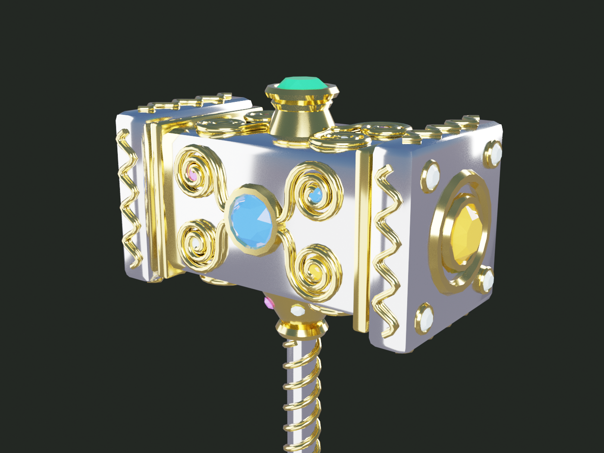

# Knochenbrecher – ein Valheim-Mod

Ein riesiger Zweihand-Hammer, gemacht, um dem **Knochenwanst** (Bonemass) eins auf den Kopp zu geben.

Der Knochenwanst steckt Hieb- und Stichschaden gut weg, ist aber anfällig für **Wucht-** und
**Geisterschaden**. Der Knochenbrecher macht genau das und haut gegen den Knochenwanst noch einmal
zusätzlich zu. **BONK!**



Poliertes Silber, goldene Schnörkel, bunte Edelsteine und ein langer Stiel. Das Bild stammt aus
Blender; im Spiel beleuchtet Valheim den Hammer selbst, dort wirkt er etwas schlichter.

## Was der Hammer kann

| Eigenschaft | Wert |
|---|---|
| Wucht | 75 (+8 pro Stufe) – der Eisenvorschlaghammer hat 35 |
| Geist | 25 (+5 pro Stufe) |
| Bonus gegen den Knochenwanst | ×1,5 auf den eigenen Schaden des Hammers (Stufe 1: 112,5 Wucht + 37,5 Geist) |
| Rückstoß | 180 |
| Taumeln | ×2 |
| Größe | 1,6-mal so lang wie der Eisenvorschlaghammer |
| Wirkungsradius | ×1,3 |
| Max. Stufe | 4 |

Grundlage ist der Eisenvorschlaghammer: gleiche Animationen, gleicher Flächenschlag, aber eigenes
Aussehen, größer und härter. Alle Werte lassen sich in der Konfigurationsdatei ändern (siehe unten).

## Rezept

Herstellen an der **Schmiede ab Stufe 2**:

- 20× Eisen
- 10× Uralte Rinde
- 5× Glibber
- 1× Draugr-Trophäe

Pro Aufwertung: 10× Eisen, 5× Uralte Rinde.

Alles davon findest du im Sumpf, also genau dort, wo der Knochenwanst wohnt.

## Installation (von Hand)

Voraussetzung: **BepInEx** ist schon installiert, im Valheim-Ordner gibt es also den Ordner
`BepInEx/plugins/`.

> **Koop:** Jeder Mitspieler muss die folgenden Schritte machen, auch der Host. Wer den Mod nicht hat,
> kann der Welt nicht beitreten und bekommt eine entsprechende Meldung.

1. **Valheim-Ordner öffnen:** In Steam Rechtsklick auf Valheim → **Verwalten → Lokale Dateien durchsuchen**.
2. **Jötunn installieren oder aktualisieren** (mindestens Version 2.30.3, passend zu Valheim 1.0):
   - Auf <https://thunderstore.io/c/valheim/p/ValheimModding/Jotunn/> auf **Manual Download** klicken.
   - Aus dem heruntergeladenen ZIP die Datei `Jotunn.dll` nach `Valheim/BepInEx/plugins/` kopieren.
3. **Knochenbrecher installieren:**
   - In `Valheim/BepInEx/plugins/` einen Ordner `Knochenbrecher` anlegen.
   - Aus `Knochenbrecher-1.2.0.zip` die Dateien `Knochenbrecher.dll` und `knochenbrecher_icon.png`
     dort hineinkopieren.
4. Valheim normal starten.

Danach sieht es so aus:

```
Valheim/
└── BepInEx/
    └── plugins/
        ├── Jotunn.dll
        └── Knochenbrecher/
            ├── Knochenbrecher.dll
            └── knochenbrecher_icon.png
```

**Ob es geklappt hat:**

- In `Valheim/BepInEx/LogOutput.log` steht die Zeile `Knochenbrecher 1.2.0 geladen – bereit zum Bonk.`
- In der Schmiede (Stufe 2) taucht der Knochenbrecher bei den Waffen auf, sobald du die Zutaten schon
  einmal aufgehoben hast.
- Zum schnellen Testen in einer Testwelt: Konsole mit `F5` öffnen, `devcommands` eingeben, dann
  `spawn SledgeKnochenbrecher`. Falls sich die Konsole nicht öffnet: in Steam unter
  **Valheim → Eigenschaften → Startoptionen** `-console` eintragen.

## Einstellungen

Nach dem ersten Start mit dem Mod liegt die Datei
`Valheim/BepInEx/config/ady.valheim.knochenbrecher.cfg` vor. Öffnen kannst du sie mit einem normalen Texteditor.
Dort kannst du Schaden, Bonus, Größe, Reichweite und Rezept ändern.

Im Koop gelten automatisch die **Einstellungen des Hosts** bzw. Servers – sie werden beim Beitreten an
alle Mitspieler übertragen. Es reicht also, wenn der Host die Datei anpasst. Nur die „BONK“-Meldung kann jeder für sich ein- oder ausschalten.

Rezept-Zutaten werden mit ihrem internen Namen angegeben, z. B. `Iron`, `ElderBark`, `Guck`,
`TrophyDraugr`, `Bronze`, `Wood`, `FineWood`.

## Testmodus

Zum Ausprobieren ohne Spielfortschritt: Steht in der Konfigurationsdatei unter `5 - Test` der Eintrag
`Testmodus = true`, bekommt jeder Spieler beim Betreten der Welt einen Knochenbrecher ins Inventar,
falls er noch keinen hat. In der ZIP liegt dafür im Ordner `Testmodus` eine fertige
Konfigurationsdatei samt Anleitung (`TESTEN.txt`).

Im Koop gilt die Einstellung des Hosts. Für das normale Spiel bleibt der Testmodus aus.

## Aussehen

Das Modell steckt in der `Knochenbrecher.dll` und wird beim Start an den Eisenvorschlaghammer
angepasst. Falls dabei etwas nicht passt, gibt es in der Konfigurationsdatei unter `4 - Aussehen`
zwei Schalter (wirken nach einem Neustart, jeder Spieler stellt sie für sich ein):

- **Modell umdrehen:** einschalten, wenn der Hammer verkehrt herum in der Hand liegt.
- **Eigenes Modell:** ausschalten, um wieder das Aussehen des Eisenvorschlaghammers zu bekommen.

Glänzt das Metall im Spiel nicht richtig, hilft die Zeile `Hammer-Shader: …` aus
`BepInEx/LogOutput.log` bei der Fehlersuche.

## Hinweise

- Gebaut für **Valheim 1.0** (kompiliert gegen die Spieldateien von 1.0.21 und Jötunn 2.30.3). Wenn ein
  großes Valheim-Update erscheint, kann es sein, dass der Mod angepasst werden muss.
- Den Mod aus dem Spiel nehmen: Hammer vorher ablegen bzw. in eine Truhe legen, sonst verschwindet
  er beim nächsten Start ohne Mod aus dem Inventar.

## Selbst bauen

Voraussetzung: .NET SDK 8. Dann im Ordner `Knochenbrecher`:

```bash
./build.sh
dotnet run -c Release --project tests/ModelTest   # prüft Lage und Ausrichtung des Modells
```

Das Ergebnis liegt in `dist/Knochenbrecher-<Version>.zip`.

Das 3D-Modell entsteht per Skript in Blender (getestet mit 4.0) – Form, Farben und Steine lassen sich
in `tools/make_hammer.py` ändern:

```bash
blender -b -P tools/make_hammer.py -- docs   # Modell + Vorschaubilder
python3 tools/make_icons.py                  # Symbole (benötigt Pillow)
./build.sh
dotnet run -c Release --project tests/ModelTest   # prüft Lage und Ausrichtung des Modells
```

## Lizenz

GPL-3.0, siehe [LICENSE](../LICENSE). Der Quellcode liegt unter
<https://github.com/ShuttleMythos/valheim-mods>.
