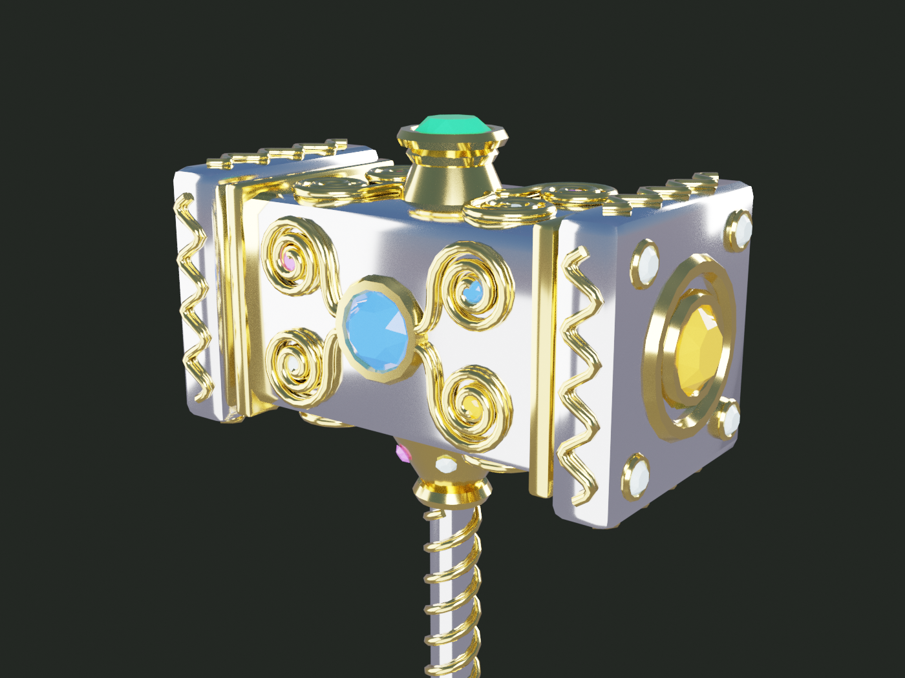

# valheim-mods

Valheim Mods für die Zockerrunde

## Mods

| Mod | Was er macht | Version | Download |
|---|---|---|---|
| [Knochenbrecher](Knochenbrecher/) | Riesiger Hammer aus Silber, Gold und Edelsteinen, gemacht um dem Knochenwanst eins auf den Kopp zu geben | 1.1.1 | [ZIP](Knochenbrecher/dist/Knochenbrecher-1.1.1.zip) |



## Installation

Alle Mods brauchen **BepInEx** und **Jötunn** (mindestens 2.30.3) und sind für **Valheim 1.0** gebaut.
Jeder Mitspieler muss einen Mod selbst installieren, auch der Host – Valheim verteilt Mods nicht
automatisch.

Die Schritte stehen in der `INSTALLATION.txt`, die in jeder ZIP liegt, und ausführlich in der README
des jeweiligen Mods.

## Aufbau

```
valheim-mods/
├── build/ValheimMod.props   gemeinsame Einstellungen zum Kompilieren (Spielversion, Jötunn, BepInEx)
├── NuGet.config             Paketquellen
└── Knochenbrecher/          ein Ordner pro Mod: Code, Modell, Anleitung, fertige ZIP unter dist/
```

Ein neuer Mod bekommt einen eigenen Ordner und bindet in seiner `.csproj` die gemeinsamen
Einstellungen ein:

```xml
<Import Project="../build/ValheimMod.props" />
```

Nach einem Valheim-Update werden die Versionen nur in `build/ValheimMod.props` angepasst.

## Lizenz

GPL-3.0, siehe [LICENSE](LICENSE).
